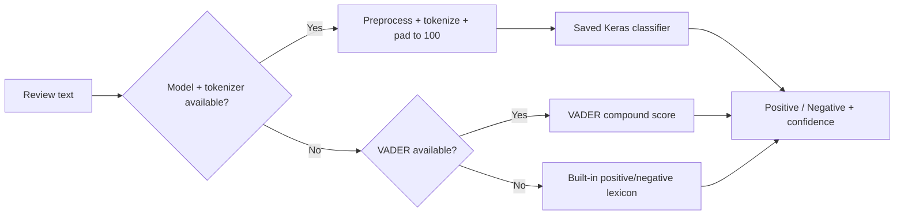

<div align="center">


**A Streamlit sentiment-analysis interface backed by an optional TensorFlow model with local fallbacks.**


</div>

## Overview

SENSE-AI classifies IMDb-style movie reviews as positive or negative through an interactive Streamlit application. When the trained model file is available, the app loads a saved Keras model and tokenizer for sequence-based inference. If the model cannot be loaded, it falls back to NLTK VADER and finally to a small built-in sentiment lexicon.

The repository also includes notebooks for preprocessing the IMDb review dataset, comparing neural architectures, training an LSTM classifier, and testing saved artifacts against a small curated review set.

## Key Features

- Positive/negative sentiment prediction from free-form review text.
- Optional TensorFlow/Keras LSTM inference using a saved tokenizer and model.
- VADER fallback when the neural model is unavailable.
- Lightweight lexical fallback when NLTK sentiment data cannot be loaded.
- Text normalization, HTML removal, alphabetic filtering, and stopword removal.
- Confidence and normalized sentiment-score display.
- Sample-review selector and compact IMDb-style review catalog.
- Custom Streamlit interface with a cinema-inspired visual design.

## How Prediction Works



The decision threshold is `0.5`. Confidence is calculated as the model score for positive predictions and `1 - score` for negative predictions.

## Model Development

The training notebook uses the IMDb review dataset and performs:

- an 80/20 train-test split;
- stopword-aware text preprocessing;
- Keras tokenization with a maximum sequence length of 100;
- 100-dimensional GloVe embeddings;
- comparisons between dense, convolutional, and LSTM classifiers.

The saved notebook output records an LSTM test accuracy of **86.83%** with a test loss of **0.3575** on that notebook's held-out split. This is a retained experiment result, not a guarantee for arbitrary reviews or the fallback engines.

## Project Structure

```text
SENSE-AI/
├── app.py                                      # Streamlit application
├── tokenizer.json                              # Saved training tokenizer
├── IMDb_TOP50_Reviews.csv                      # Curated sample reviews
├── sentiment-analysis-imdb-movie-reviews.ipynb # Training and model comparison
├── sentiment-analysis-model-testing.ipynb      # Saved-model testing workflow
├── LICENSE
└── README.md
```

The trained `sentiment_classifier2.h5` model and full `IMDb Dataset.csv` training data are referenced by the code and notebooks but are not committed to this repository. The original project documentation points to the external project files on Kaggle:

[Download the SENSE-AI model/data files](https://www.kaggle.com/datasets/shahzaibalyy/sense-ai-files)

## Installation

### Basic App with Fallback Inference

```powershell
git clone https://github.com/FarisDosani/SENSE-AI.git
cd SENSE-AI

py -3.13 -m venv venv
.\venv\Scripts\Activate.ps1
pip install streamlit pandas nltk
python -m streamlit run app.py
```

Streamlit prints the local application URL after startup.

### TensorFlow Model Inference

To use the trained neural classifier:

1. Install TensorFlow/Keras in the same environment.
2. Place `sentiment_classifier2.h5` in the repository root.
3. Keep the matching `tokenizer.json` beside it.
4. Restart the Streamlit app.

```powershell
pip install tensorflow
python -m streamlit run app.py
```

When both files load successfully, the sidebar reports **TensorFlow LSTM** as the active backend. Otherwise, the app continues with a fallback engine.

## Usage

1. Open the Streamlit URL.
2. Choose a sample title when sample data is available, or enter a custom review.
3. Select **Predict Sentiment**.
4. Review the positive/negative label, sentiment score, confidence, and active backend.

The application expects `IMDb Dataset.csv` for its optional sample catalog. The repository currently includes `IMDb_TOP50_Reviews.csv`; rename or replace the file only in your local environment if you want that dataset to populate the app without changing the source path.

## Technical Notes

- Neural inference uses sequences padded to 100 tokens.
- The tokenizer and model must come from the same training run.
- NLTK resources may be downloaded automatically on first use.
- TensorFlow is imported only when both neural artifacts are present.
- The fallback paths keep the interface usable but are not equivalent to the trained LSTM.
- No claim is made that the model reliably detects sarcasm or every form of nuanced sentiment.

## Attribution

This repository is a fork of [shah-zaib-ali/SENSE-AI](https://github.com/shah-zaib-ali/SENSE-AI). Original project history and contributor credit are preserved through the fork relationship.

Licensed under the [MIT License](LICENSE).

---

<div align="center">

<a href="https://github.com/FarisDosani/SENSE-AI">View repository</a> · <a href="https://github.com/shah-zaib-ali/SENSE-AI">Upstream project</a>


</div>
